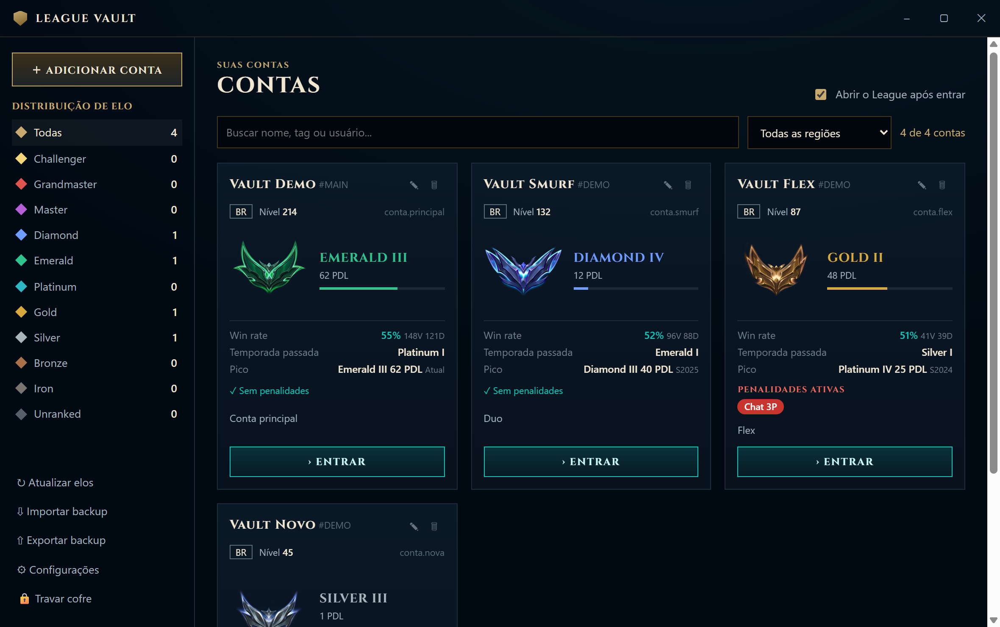
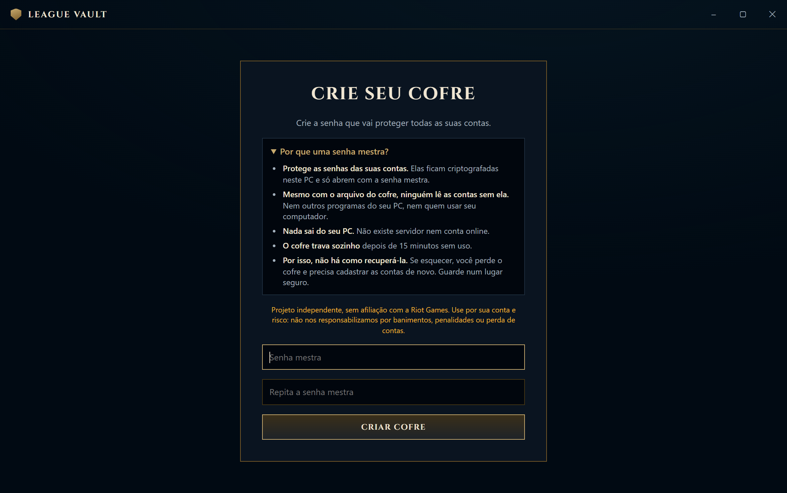
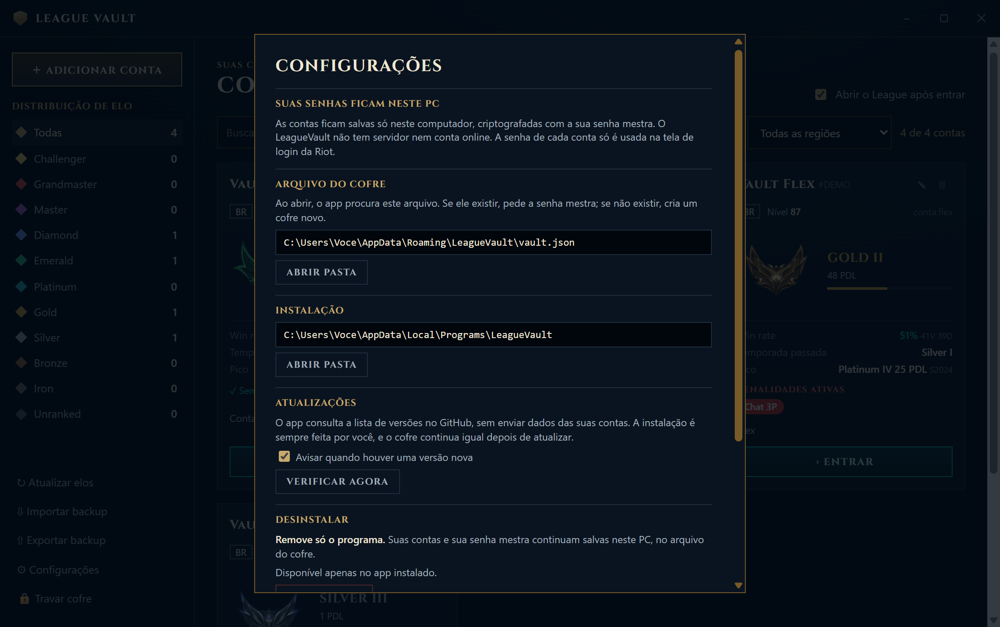

# LeagueVault


Cofre local para as suas contas do League of Legends, com login em um clique.



<table>
  <tr>
    <td></td>
    <td></td>
  </tr>
</table>

<sub>Imagens com contas fictícias. Os emblemas de elo pertencem à Riot Games.</sub>

- **Local:** sem servidor próprio, sem telemetria e sem instalação automática de atualizações. O app só acessa o OP.GG (elos), o whatismymmr.com (MMR), a CommunityDragon (imagens de elo), o GitHub (aviso de versão nova, que pode ser desligado) e o Riot Client do seu PC. Nenhuma senha sai do seu PC.
- **Senha mestra:** contas criptografadas com AES-256-GCM e chave Argon2id. O cofre trava após 15 minutos parado.
- **A interface nunca recebe as senhas:** só o processo principal do Electron as lê, na hora do login.
- **Troca de conta:** encerra a sessão atual, entra na escolhida e abre o League.
- **Captcha e 2FA não são burlados:** a janela da Riot abre para você resolver.
- **Elo automático:** vem do OP.GG ao abrir o cofre e a cada 30 minutos, e do cliente do League quando você entra na conta. O OP.GG pode ficar atrasado, então o valor do cliente só é substituído quando o OP.GG tem uma partida mais recente.
- **Estatísticas:** win rate, temporada passada, pico e nível.
- **MMR estimado:** só para NA, EUW, EUNE e KR, as regiões cobertas pelo whatismymmr.com. A Riot não divulga o MMR, e a busca usa só o nome, então pode vir de outro jogador com o mesmo nome.
- **Penalidades:** banimento, restrição de chat e de ranqueada e honra baixa, com a última leitura de cada conta.
- **Backup:** é o próprio arquivo criptografado; abre em outro PC com a mesma senha mestra.

> **Sem recuperação:** se esquecer a senha mestra, não há como recuperar as contas.

## Instalação

1. Abra a página de [Releases](https://github.com/gabrielbonin/LeagueVault/releases) e escolha a versão mais recente.
2. Em **Assets**, baixe `LeagueVault.Setup.<versão>.exe`.
3. Execute o instalador. Por enquanto o app não tem assinatura digital, então o Windows pode mostrar o alerta do SmartScreen: clique em **Mais informações** e depois em **Executar assim mesmo**.

Para conferir o arquivo, compare o resultado do comando abaixo com o SHA-256 publicado na release:

```powershell
Get-FileHash "LeagueVault.Setup.0.1.2.exe" -Algorithm SHA256
```

As contas ficam só no seu PC, em `%APPDATA%\LeagueVault\vault.json`. Se esse arquivo já existir, o app pede a senha mestra em vez de criar um cofre novo.

Em **Configurações** você vê esses caminhos e encontra:

- **Desinstalar:** remove só o programa. Suas contas e sua senha mestra continuam salvas no PC.
- **Apagar dados locais:** apaga as contas e a senha mestra, sem como desfazer. Backups exportados não são apagados.
- **Atualizações:** o app avisa quando sai uma versão nova, e você pode desligar o aviso. A instalação é sempre feita por você.

## Aviso importante

**O LeagueVault é um projeto independente, sem qualquer afiliação, aprovação ou patrocínio da Riot Games.** League of Legends e Riot Games são marcas da Riot Games, Inc.

- **Use por sua conta e risco.** Automatizar o login pode contrariar os Termos de Serviço da Riot.
- **Os autores não se responsabilizam** por banimentos, suspensões, restrições, penalidades, perda de contas ou de dados, ou qualquer outro prejuízo decorrente do uso deste software.
- **Compartilhar contas é contra os termos da Riot.** Este projeto serve para organizar as suas próprias contas.
- **Sem garantias.** O software é fornecido "como está", conforme a licença MIT.

As imagens de elo são carregadas da CommunityDragon na hora de exibir e pertencem à Riot Games; o app não as inclui.

### Disclaimer (English)

LeagueVault is an independent project, not affiliated with, endorsed or sponsored by Riot Games. Use it at your own risk: automating login may violate Riot's Terms of Service. The authors are not responsible for bans, suspensions, restrictions, penalties, lost accounts or data, or any other damage arising from the use of this software. It is provided "as is", under the MIT License.

## Desenvolvimento

Requer Windows e Node 22 ou mais novo.

```bash
npm install
node node_modules/electron/install.js
npm run dev
```

| Comando | O que faz |
|---|---|
| `npm test` | Testes |
| `npm run typecheck` | Verificação de tipos |
| `npm run dist` | Gera o instalador em `dist/` |

## Estrutura

| Caminho | Conteúdo |
|---|---|
| `src/main/vault.ts` | Cofre criptografado |
| `src/main/riot.ts` | Automação do Riot Client |
| `src/main/ranks.ts` | Leitura do elo no OP.GG |
| `src/main/index.ts` | Janela, IPC e trava automática |
| `src/preload/index.ts` | Ponte segura com a interface |
| `src/renderer/` | Interface React |

Licença MIT. Veja `LICENSE` e `NOTICE`.
